# TurtleBot3 仿真机器人实验报告

姓名：____________　学号：____________　日期：2026-10-26

实验环境：Ubuntu 22.04 LTS / ROS 2 Humble / Gazebo Classic 11.10.2 /
TurtleBot3 Burger / Cartographer 2D / Navigation2

代码位置：`~/turtlebot3_ws/src/tb3_course`

---

## 第二节 ROS2 与 TurtleBot3 基础

### 2.9 课后练习

#### 1. 用 `ros2 topic pub` 控制小海龟走直线和旋转

走直线（持续 1 秒左右）：

```bash
ros2 topic pub -r 10 /turtle1/cmd_vel geometry_msgs/msg/Twist \
  "{linear: {x: 1.0}}"
```

原地旋转：

```bash
ros2 topic pub -r 10 /turtle1/cmd_vel geometry_msgs/msg/Twist \
  "{angular: {z: 1.0}}"
```

`linear.x` 是前进速度（m/s），`angular.z` 是绕 z 轴的角速度（rad/s），
逆时针为正。`/turtle1/cmd_vel` 的消息类型是
`geometry_msgs/msg/Twist`，可以用 `ros2 topic info /turtle1/cmd_vel`
确认。

#### 2. 修改 circle 节点，使圆的半径变大或变小

匀速圆周运动的半径由 `r = v / ω` 决定。原教程固定
`linear.x = 1.0`、`angular.z = 1.0`，所以半径是 1.0 m。本实验把
`radius` 做成 ROS 参数：

```bash
# 半径 0.5 m：v=1.0, w=2.0
ros2 run tb3_course circle --ros-args -p radius:=0.5

# 半径 2.0 m：v=1.0, w=0.5
ros2 run tb3_course circle --ros-args -p radius:=2.0

# 运行中也可以改
ros2 param set /circle_publisher radius 1.5
```

实测 `radius:=0.5` 时 `/turtle1/cmd_vel` 为：

```text
linear.x = 1.0
angular.z = 2.0
```

与 `r = v/ω = 0.5 m` 一致。

进一步用 `/turtle1/pose` 记录 12 s 轨迹并拟合圆心/半径：

| 参数 | 平均实测半径 | 最小/最大半径 |
|---|---|---|
| `radius:=0.5` | 0.499 m | 0.476 / 0.524 m |
| `radius:=2.0` | 1.997 m | 1.905 / 2.094 m |

轨迹 CSV：`homework/data/circle_r0.5.csv`、`circle_r2.0.csv`；
对比图：`homework/screenshots/02_circle_radius_compare.png`。
两个半径的圆心不同，是因为每次 `reset` 后小海龟朝向相同、半径不同，
圆心相对起点的偏移自然不同（圆心 = 起点 + r·法向）。

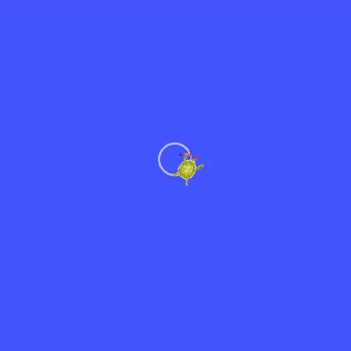

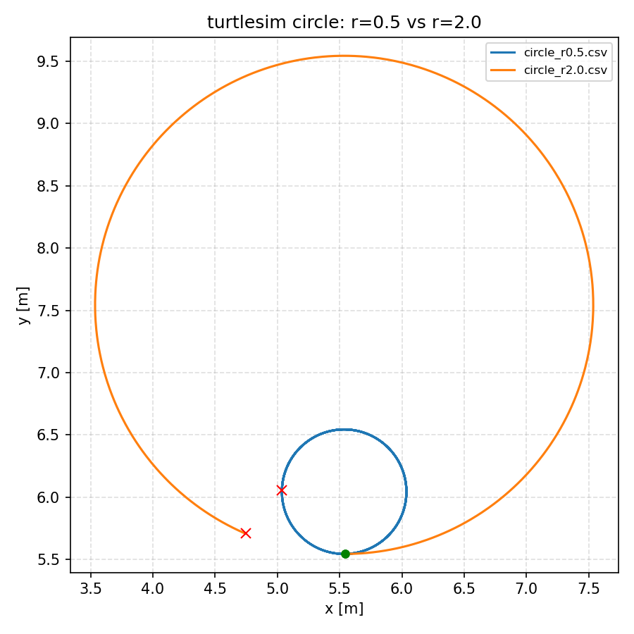

[▶ 观看画圆视频（r=0.5，8 s）](../videos/02_circle.mp4)

#### 3. 用 rqt_graph 画出节点和话题连接

运行：

```bash
ros2 run turtlesim turtlesim_node
ros2 run tb3_course circle
ros2 run tb3_course pose_listener
rqt_graph
```

图中应看到：

```text
/circle_publisher  --/turtle1/cmd_vel-->  /turtlesim
/pose_listener     <--/turtle1/pose----   /turtlesim
```

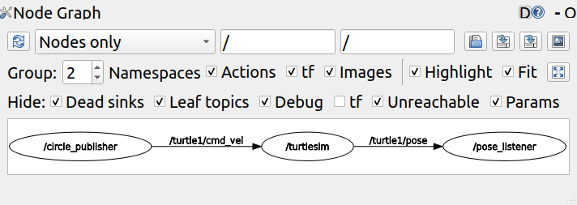

#### 4. Fake Node 与 Gazebo 的话题差异

| 项目 | `turtlebot3_fake_node` | Gazebo (`turtlebot3_world`) |
|---|---|---|
| 物理引擎 | 无，只做运动学/关节状态 | ODE 刚体物理、碰撞 |
| `/clock` | 通常无（默认 `use_sim_time=false`） | 有，仿真时间 |
| `/scan` | 没有真实激光数据（本机实测 publisher 数为 0） | 有真实 `LaserScan`，360 束，range 0.12–3.5 m |
| `/odom` | 有，由假节点积分得到 | 有，由差速驱动插件发布（世界坐标） |
| `/imu` | 无 | 有 |
| `/joint_states`、`/tf` | 有 | 有 |
| 用途 | 模型、关节、基本运动教学 | SLAM、导航、避障、传感器实验 |

实测 Fake Node 的 `/odom` 会随 `/cmd_vel` 变化（前进 2 s，x≈0.42 m），
但它不能替代 Gazebo 的激光/碰撞环境。

---

## 第三节 TurtleBot3 Gazebo 仿真环境的搭建与测试

### 3.9 课后练习

#### 1. 切换模型并观察差异

```bash
export TURTLEBOT3_MODEL=burger
ros2 launch turtlebot3_gazebo empty_world.launch.py

export TURTLEBOT3_MODEL=waffle
ros2 launch turtlebot3_gazebo empty_world.launch.py
```

Burger 使用 360° LDS-01 激光雷达、两轮差速 + 万向轮，没有相机；
Waffle / Waffle Pi 在 Burger 基础上增加相机（Waffle Pi 为
Raspberry Pi 相机套件），轮距、底盘尺寸和 URDF 也不同。
切换后 `ros2 topic list` 会多出相机相关话题，`robot_description`
里的 link/joint 数量也会变化。

#### 2. 启动 `turtlebot3_world.launch.py`，观察 `/scan`

```bash
ros2 launch turtlebot3_gazebo turtlebot3_world.launch.py
ros2 topic hz /scan
ros2 topic echo /scan --once
```

实测 `/scan`：

- 360 束，`angle_min=0.0`，`angle_max≈6.28`（0–360°）
- `range_min=0.12 m`，`range_max=3.5 m`
- 324 个有限值，min≈0.505 m，median≈1.053 m，max≈3.328 m
- 没有出现 TB4/Ignition 上那种“所有值都被钳到 0.164 m”的现象

原因：TurtleBot3 在 Gazebo Classic 中使用 CPU 射线传感器
（`libgazebo_ros_ray_sensor`），不依赖 GPU 离屏渲染；TB4 的
Ignition `gpu_lidar` 才会受 NVIDIA PRIME/EGL 配置影响。

#### 3. 修改 move_square 的速度和边长

`move_square.py` 把速度、每边时间和转向时间做成参数：

```bash
ros2 run tb3_course move_square --ros-args \
  -p use_sim_time:=true \
  -p linear_speed:=0.12 \
  -p side_time:=3.0 \
  -p turn_time:=2.0
```

开环控制下，机器人按“走 3 s、转 2 s”循环四次。实测起点
(-2.000, -0.500)，终点 (-2.344, -0.508)，闭合误差约 **0.344 m**。
误差来自计时误差、加速过程和轮子打滑；开环没有反馈，误差会累积。

#### 4. 拓展：基于 `/odom` 实现闭环正方形

`square_odom.py` 的状态机：

1. 记录本边起点，向前走到“离起点 side_length 米”；
2. 用当前 yaw 计算目标 yaw = 名义航向 + 90°，原地转到目标；
3. 直行时用航向 P 控制抑制左右轮差；
4. 重复四次，输出回到起点的闭合误差。

运行：

```bash
ros2 run tb3_course square_odom --ros-args \
  -p use_sim_time:=true \
  -p side_length:=0.4 \
  -p linear_speed:=0.15 \
  -p angular_speed:=0.6
```

实测起点 (-2.000, -0.500, yaw=0)，终点 (-1.992, -0.496)，闭合误差
约 **0.005 m**。

| 控制方式 | 边长 | 闭合误差 |
|---|---|---|
| 开环 `move_square` | 0.36 m | 0.344 m |
| 闭环 `square_odom` | 0.40 m | 0.005 m |

结论：闭环反馈把误差从分米级降到毫米级；开环只适合演示，实际
移动机器人必须使用传感器/里程计反馈。

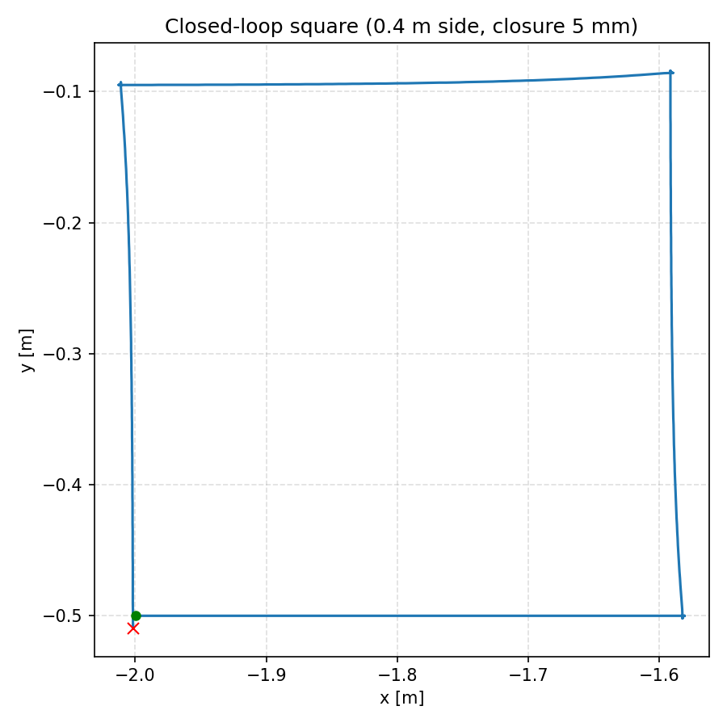

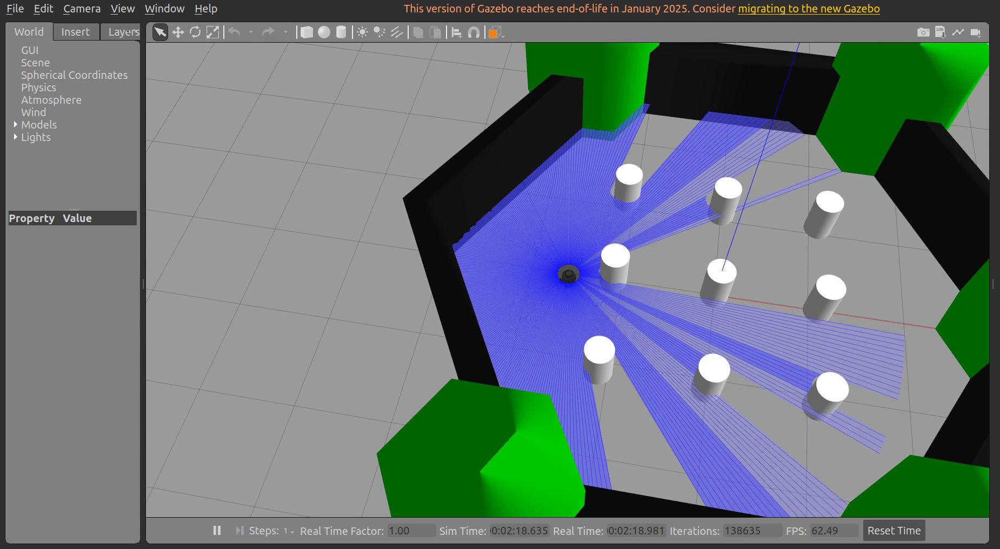

[▶ 观看闭环正方形视频（25 s）](../videos/03_square_odom.mp4)

---

## 第四节 Cartographer SLAM：创建与保存地图

### 4.7 课后练习

#### 1. 提交 PGM、YAML 和 RViz2 建图截图

启动：

```bash
# 终端 1
ros2 launch turtlebot3_gazebo turtlebot3_world.launch.py

# 终端 2
ros2 launch turtlebot3_cartographer cartographer.launch.py use_sim_time:=True

# 终端 3：自动巡航建图（本课程提供的辅助节点）
ros2 run tb3_course auto_mapper --ros-args -p use_sim_time:=true
```

保存：

```bash
mkdir -p ~/maps
ros2 run nav2_map_server map_saver_cli -f ~/maps/tb3_world
```

产物：

- `homework/maps/tb3_world.pgm`
- `homework/maps/tb3_world.yaml`
- `homework/screenshots/04_cartographer_rviz.png`

实测地图：

- 124 × 115 栅格，分辨率 0.05 m/像素（约 6.2 m × 5.75 m）
- `origin = [-1.21, -2.37, 0]`
- 空闲 7882 格（55.3%），占据 805 格（5.6%），未知 5573 格（39.1%）

未知区域主要是六边形墙外的空间；墙内六边形边界和 9 个圆柱轮廓闭合。

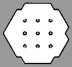

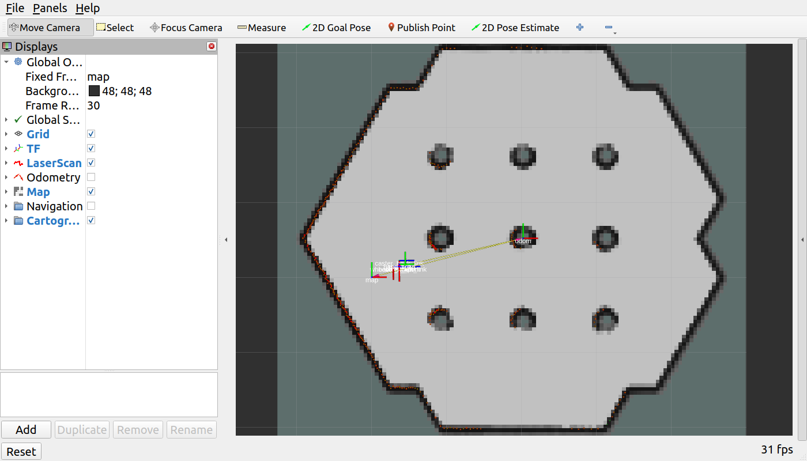

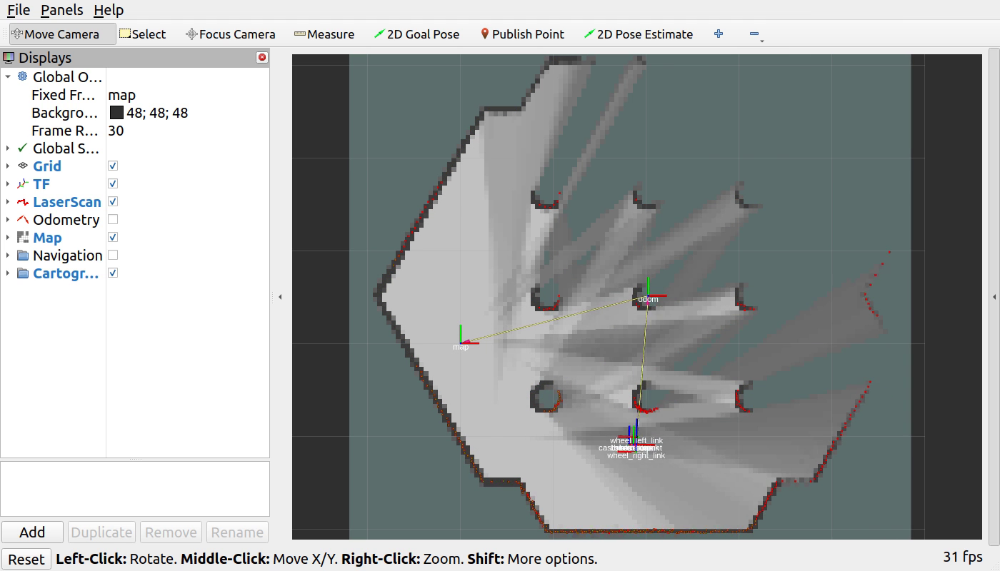

[▶ 观看建图片段（40 s）](../videos/04_mapping.mp4)

[▶ 观看完整一圈加速版（约 30 s，8×）](../videos/04_mapping_full.mp4)

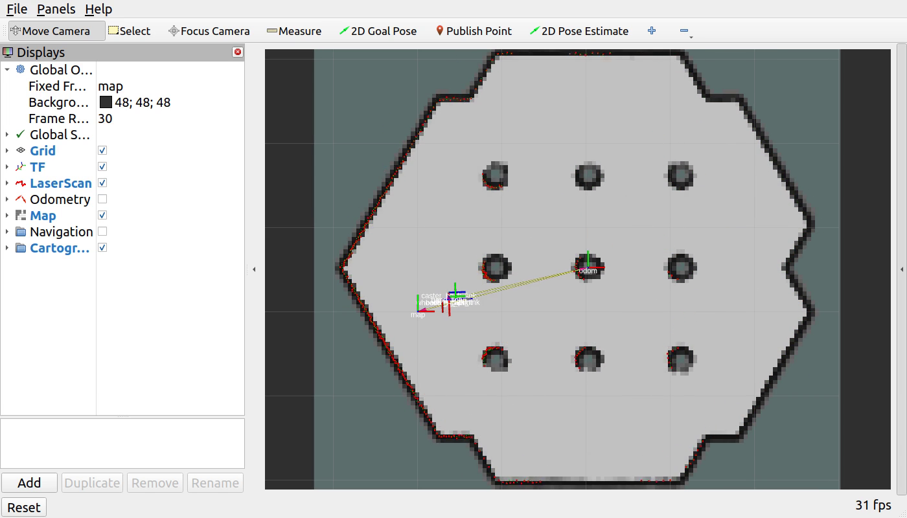

#### 2. 解释 map、odom、base_footprint 的区别

| 坐标系 | 性质 | 来源 | 用途 |
|---|---|---|---|
| `map` | 全局、固定、可跳变 | SLAM（Cartographer/AMCL） | 全局路径规划、代价地图、保存地图 |
| `odom` | 局部、连续、会漂移 | 轮式里程计/IMU | 局部规划、短期运动估计 |
| `base_footprint` | 机器人本体在地面的投影 | URDF/TF | 表示机器人位姿，挂载 `base_link` |

典型 TF 链：

```text
map → odom → base_footprint → base_link → base_scan
```

- `map → odom` 由 SLAM/定位模块发布，用来修正里程计漂移；
  回环检测时这个变换可能发生跳变。
- `odom → base_footprint` 由差速驱动插件发布，连续但会累积误差。
- `base_footprint` 是机器人在地面上的参考点，`base_link` 在其上方，
  激光雷达 `base_scan` 再通过静态 TF 挂在 `base_link` 上。

#### 3. 拓展：比较 Cartographer 与 slam_toolbox

| 维度 | Cartographer | slam_toolbox |
|---|---|---|
| 来源 | Google Cartographer | Steve Macenski / ROS 社区 |
| 核心方法 | 子图 + 扫描匹配 + 回环检测 + 位姿图优化 | Karto / 图优化，2D 扫描匹配 |
| 配置 | Lua 配置文件，参数较多 | YAML/ROS 参数，ROS2 原生 |
| 传感器 | 2D/3D LiDAR，可选 IMU | 2D LiDAR，可选 odom |
| 优点 | 回环稳健，大场景精度好，支持 3D | 轻量、易集成、支持 lifelong mapping |
| 缺点 | 配置复杂，编译/运行较重 | 大场景回环和 3D 支持不如 Cartographer |
| 本课程 | TB3 官方教程默认 | 可作为替代方案 |

本课程选 Cartographer 是因为 TurtleBot3 官方 Humble 教程默认使用它，
且 2D 建图效果稳定；slam_toolbox 更适合快速集成和长期建图。

#### 4. 拓展：调研 3D SLAM，为何本课程不直接使用它

3D SLAM 同时估计机器人的 6 自由度位姿（x, y, z, roll, pitch, yaw）并
构建三维点云/体素地图。常见方案：

- LiDAR SLAM：LOAM、LeGO-LOAM、LIO-SAM、FAST-LIO
- 视觉 SLAM：ORB-SLAM3、RTAB-Map
- 多传感器融合：LiDAR + IMU + 相机

本课程不直接使用 3D SLAM 的原因：

1. TurtleBot3 Burger 只有单线 2D 激光雷达，没有 3D LiDAR/深度相机，
   硬件上不具备完整 3D SLAM 条件；
2. 课程目标是 2D 栅格地图 + Nav2 导航，2D 地图可以直接用于
   costmap 和路径规划；
3. 3D SLAM 计算量大、内存占用高，在普通笔记本上会明显拖慢
   Gazebo + RViz；
4. 3D 点云需要投影/降维才能用于 2D 导航，增加课程复杂度。

3D SLAM 更适合作为研究型拓展，而不是基础实验。

---

## 第五节 Navigation2：自主导航、避障与程序化目标

### 5.9 课后练习

#### 1. RViz2 设置 3 个目标并记录路径

启动：

```bash
# 终端 1
ros2 launch turtlebot3_gazebo turtlebot3_world.launch.py

# 终端 2
ros2 launch turtlebot3_navigation2 navigation2.launch.py \
  use_sim_time:=True map:=$HOME/maps/tb3_world.yaml
```

在 RViz2 中先用 `2D Pose Estimate` 给初始位姿，再用
`Navigation2 Goal` 依次设置 3 个目标。路径可以通过订阅 `/plan`
记录，截图见 `homework/screenshots/05_nav2_goals.png`。

实测（map 坐标系，AMCL 初始位姿取 (0, 0, 0)）：

| 目标 | 坐标 (x, y, yaw) | 结果 |
|---|---|---|
| A | (1.20, 0.00, 0.00) | `status=4` SUCCEEDED |
| B | (3.65, 0.00, 0.00) | `status=4` SUCCEEDED |
| C | (3.65, 1.60, 1.57) | `status=4` SUCCEEDED |

AMCL 最终位置约 (3.72, 1.25)，与目标 C 的偏差在 goal tolerance 内。
路径记录 `homework/data/nav_paths.csv` 共记录到 26 条规划
（Nav2 在行驶过程中周期性重规划），路径图见
`homework/screenshots/05_nav2_paths.png`，里程计轨迹见
`homework/screenshots/05_nav2_odom.png`，RViz2 截图见
`homework/screenshots/05_nav2_goals.png`。

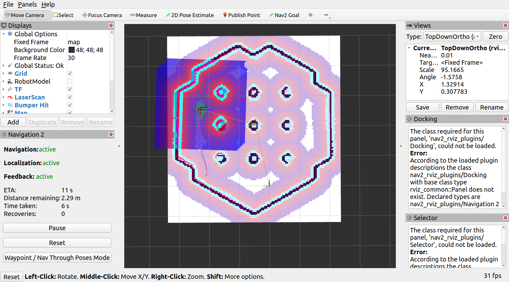

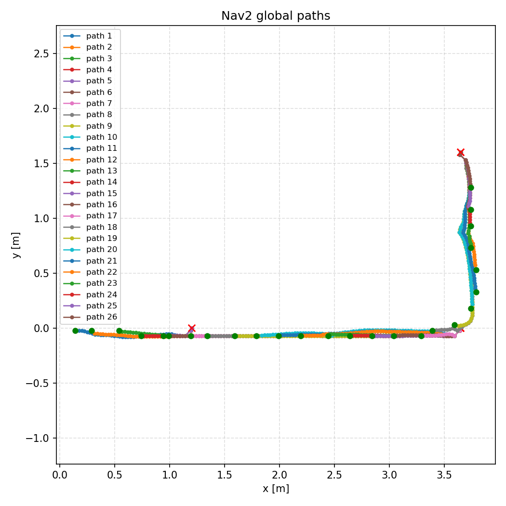

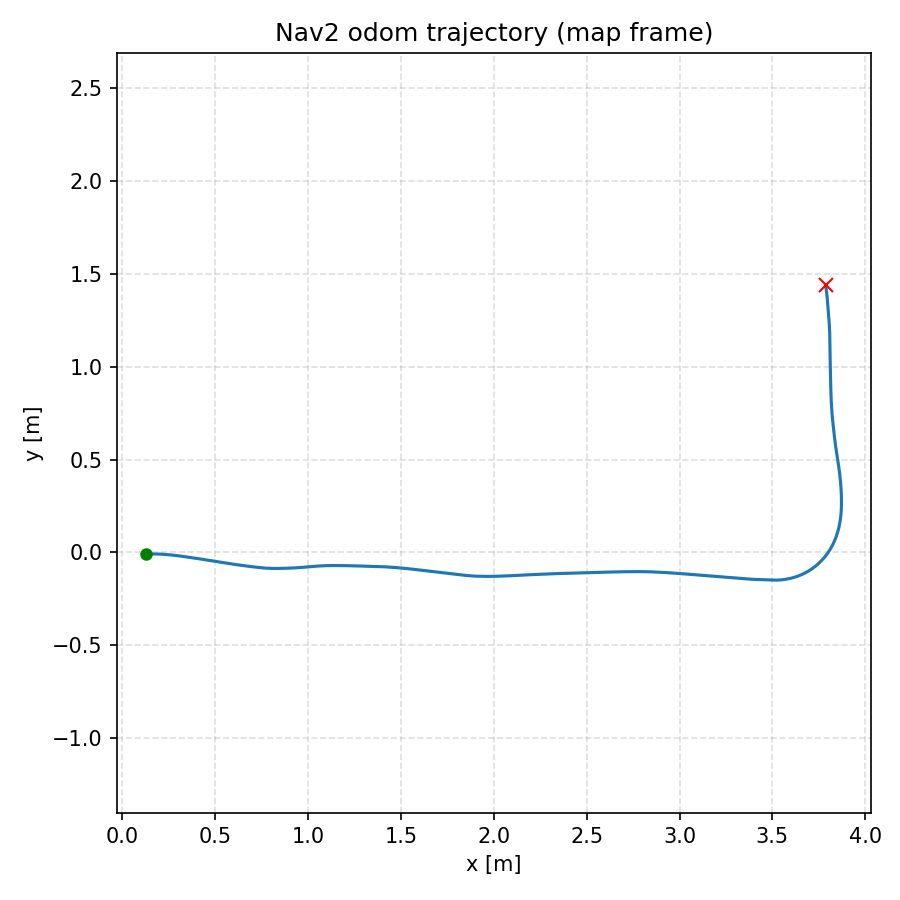

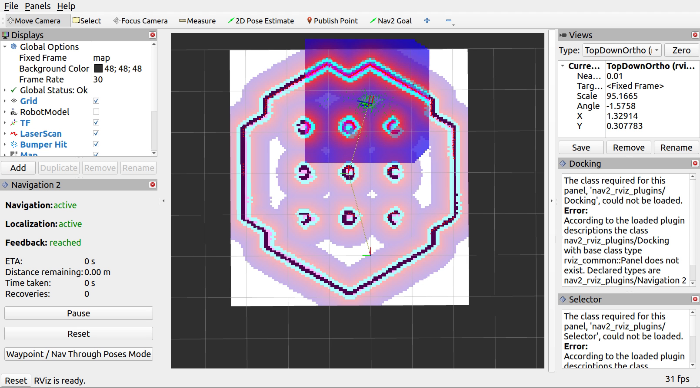

[▶ 观看 Nav2 导航视频（20 s）](../videos/05_nav2.mp4)

#### 2. 修改 nav_goal.py，支持更多参数并输出剩余距离

`nav_goal.py` 支持：

- `goal_x`、`goal_y`、`goal_yaw`：目标位姿（map 坐标系）
- `use_sim_time`：使用 Gazebo 仿真时间
- 通过 `NavigateToPose` 的 feedback 输出 `distance_remaining`

运行：

```bash
ros2 run tb3_course nav_goal --ros-args \
  -p use_sim_time:=true \
  -p goal_x:=1.0 -p goal_y:=0.5 -p goal_yaw:=0.0
```

代码在收到 feedback 时打印：

```text
Distance remaining: 1.23 m
```

#### 3. 修改 patrol.py，循环巡航两圈

`patrol.py` 增加 `loops` 参数：

```bash
ros2 run tb3_course patrol --ros-args \
  -p use_sim_time:=true -p loops:=2
```

节点按顺序发送 4 个目标；一圈结束后如果 `loop < loops`，从第一个
目标重新开始。全部完成后退出。

实测两圈共 8 个目标全部成功，日志节选：

```text
Loop 1/2, goal 1/4: (0.35, 0.00)
Loop 1/2, goal 2/4: (3.65, 0.00)
Loop 1/2, goal 3/4: (3.65, 2.15)
Loop 1/2, goal 4/4: (0.35, 2.15)
Loop 2/2, goal 1/4: (0.35, 0.00)
...
Loop 2/2, goal 4/4: (0.35, 2.15)
Patrol finished.
```

注意：`patrol.py` 的目标时间戳设置为 0（表示使用最新 TF）。
如果使用 `get_clock().now()` 且节点启动时 `/clock` 尚未同步，
Nav2 会报 `Extrapolation Error` 并卡住；本实验实际遇到过这个问题。

#### 4. 阅读 Nav2 参数，比较 planner/controller 插件

TurtleBot3 Humble 默认配置
（`/opt/ros/humble/share/turtlebot3_navigation2/param/burger.yaml`）：

| 组件 | 默认插件 | 作用 |
|---|---|---|
| 全局规划 | `nav2_navfn_planner::NavfnPlanner` | 在代价地图上做 Dijkstra/A* |
| 局部控制 | `dwb_core::DWBLocalPlanner` | 采样多组速度，按 critic 打分 |
| 行为 | `Spin`、`BackUp`、`DriveOnHeading`、`Wait`、`AssistedTeleop` | 恢复行为 |
| 代价地图 | `StaticLayer`、`ObstacleLayer`、`VoxelLayer`、`InflationLayer` | 静态/动态障碍与膨胀 |
| 进度/目标检查 | `SimpleProgressChecker`、`SimpleGoalChecker` | 卡住/到达判断 |

可替换方案：

- 全局规划：`SmacPlanner2D`（A*，支持惩罚项，速度快）、
  `SmacPlannerHybridAStar`（考虑车辆运动学）、`ThetaStarPlanner`
  （任意角度路径）。
- 局部控制：`RegulatedPurePursuitController`（路径跟踪平滑）、
  `MPPIController`（采样优化，计算量大）、`TEBLocalPlanner`
  （时间弹性带，需额外安装）。

默认参数：`max_vel_x=0.3`、`max_vel_theta=1.0`、
`robot_radius=0.1`、`inflation_radius=0.5`、`controller_frequency=10`、
`expected_planner_frequency=10`。NavFn+DWB 组合简单稳健，适合
Burger 这种小型差速机器人；Smac/RPP/MPPI 适合更大、更快或
非完整约束更强的平台。

---

## 第六节 ROS2 多机器人通信与协作

### 6.9 课后练习

#### 1. 启动两台 TurtleBot3，列出各话题

```bash
export TURTLEBOT3_MODEL=burger
ros2 launch tb3_course multi_robot_2.launch.py
```

命名空间：`/TB3_1`、`/TB3_2`。每台车都有：

```text
/TB3_1/cmd_vel   /TB3_1/odom   /TB3_1/scan
/TB3_2/cmd_vel   /TB3_2/odom   /TB3_2/scan
```

TF frame 前缀分别是 `TB3_1/...` 和 `TB3_2/...`，避免 TF 树冲突。
实测初始 odom 为世界坐标：TB3_1≈(-2.0, -0.5)，TB3_2≈(0.5, -2.0)。

实测话题：

```text
/TB3_1/cmd_vel  /TB3_1/odom  /TB3_1/scan  /TB3_1/imu
/TB3_1/joint_states  /TB3_1/robot_description
/TB3_2/cmd_vel  /TB3_2/odom  /TB3_2/scan  /TB3_2/imu
/TB3_2/joint_states  /TB3_2/robot_description
```

TF frame 前缀分别为 `TB3_1/`、`TB3_2/`。初始 odom 为世界坐标：
TB3_1≈(-2.00, -0.50)，TB3_2≈(0.50, -2.00)。

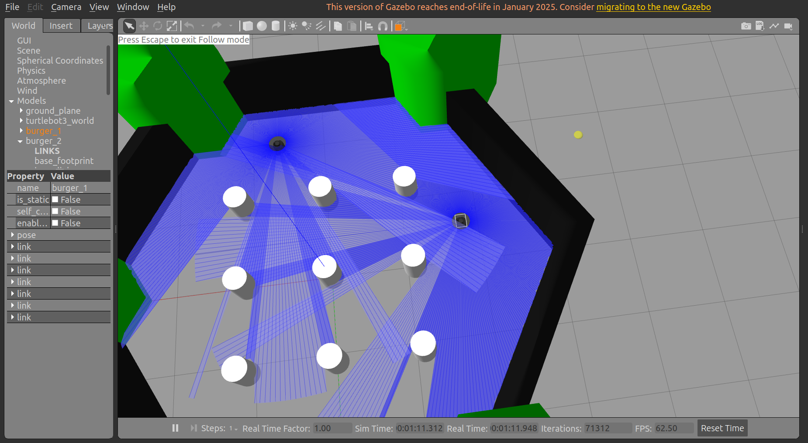

#### 2. 运行 velocity_mirror

```bash
ros2 run tb3_course velocity_mirror
ros2 run turtlebot3_teleop teleop_keyboard --ros-args -r __ns:=/TB3_1
```

`velocity_mirror` 订阅 `/TB3_1/cmd_vel`，按 `scale=0.9` 缩放后发布到
`/TB3_2/cmd_vel`。实测（安全版）：leader 从 (-2.00, -0.50) 前进到
(-1.74, -0.50)，follower 从 (0.50, -2.00) 到 (0.65, -2.00)，
`scale=0.9`；随后 leader 补零，follower 在 0.5 s 看门狗后停车。
两车 z≈0.0085，姿态保持水平；距离从 2.915 m 变为 2.820 m。

注意：这是开环镜像，不是闭环队形保持；两车动力学差异会导致队形
漂移。另外，Gazebo 的 `/cmd_vel` 会保持最后一条命令：如果 leader
发完非零速度后不补零，它会一直前进。本实验早期就发生过两车撞墙
侧翻，因此 `velocity_mirror` 增加了 `cmd_timeout=0.5 s` 看门狗，
测试脚本也在运动结束后显式发布零速度。

#### 3. 订阅两台 /odom，输出欧氏距离

```bash
ros2 run tb3_course robot_distance --ros-args -p use_sim_time:=true
```

节点同时订阅 `/TB3_1/odom` 和 `/TB3_2/odom`，每秒输出：

```text
TB3_1=(-2.00, -0.50)  TB3_2=(0.50, -2.00)  distance=2.906 m
```

并发布 `/tb3_distance`（`std_msgs/msg/Float32`）。实测初始
`distance=2.915 m`；镜像运动后为 `2.820 m`，静止时数值稳定。

#### 4. 进阶：闭环 Leader-Follower

```bash
ros2 run tb3_course leader_follower --ros-args \
  -p use_sim_time:=true -p follow_distance:=0.6
```

控制律：

1. 由 leader 位姿计算目标点
   `target = leader_xy - d * [cos(yaw), sin(yaw)]`；
2. 计算 follower 到目标点的距离 `rho` 和方位误差 `alpha`；
3. 方位误差大时原地转，误差小时用 P 控制边走边修正；
4. leader odom 超时则停车。

实测（空世界，`follow_distance=0.6`）：follower 从 (0.65, -2.00)
出发，约 20 s 后接近到 (3.65, -0.52)，与静止 leader (4.30, -0.50)
的距离为 **0.622 m**。leader 以 `v=0.1 m/s, w=0.4 rad/s` 画半径
0.25 m 的小圈时，简单 P 控制器会“切内道”，距离一度降到 0.36 m。
本轮数据是在加入安全停车之前测的；之后在代码中增加了
`min_distance=0.45 m`，距离小于该值时 follower 直接停车，避免
碰撞。更平滑的做法是加入 leader 速度前馈，或改用纯跟踪/Nav2 跟随。

#### 5. 研究型：多机器人地图融合与协同避障

多机器人 SLAM/地图融合至少涉及：

- 坐标对齐：各机器人初始位姿/地图原点不同，需要统一到同一全局坐标系；
- 数据关联：不同机器人看到的同一障碍/回环如何识别；
- 回环与位姿图：跨机器人回环检测、分布式优化；
- 地图融合：占据栅格融合、点云配准、冲突处理；
- 通信：带宽、延迟、断连，DDS domain/namespace 管理；
- 动态环境：障碍物移动、地图更新与一致性。

常见路线：集中式（一个中心节点融合各机器人子图）、分布式
（各机器人维护局部地图，周期性交换位姿/特征）、基于 pose graph
的多机器人 SLAM。Cartographer 支持多 trajectory，但跨机器人
地图融合不是“多启动几个 SLAM 节点”就能完成；本课程把它作为
研究型拓展。

---

## 实验中的关键坑与处理

1. **Gazebo 卡在加载世界，`/spawn_entity` 服务不出现。**
   `gazebo_ros` 的 launch 默认把 `GAZEBO_MODEL_PATH` 设为
   `turtlebot3_gazebo/models`，不含系统自带的 `ground_plane`、`sun`。
   本机访问 `models.gazebosim.org` 超时，世界一直加载不完。
   处理：在 `tb3_env.sh` 中补
   `GAZEBO_MODEL_PATH=/usr/share/gazebo-11/models:...`。

2. **Gazebo 会保持最后一条 `/cmd_vel`。**
   发完非零速度后如果不补零，机器人会一直运动；多机器人实验中
   leader 因此撞墙侧翻。处理：运动结束后显式发布零速度；
   `velocity_mirror` 增加 `cmd_timeout=0.5 s` 看门狗，leader 超时
   后自动给 follower 发零速度。

3. **Nav2 目标时间戳过旧导致 `Extrapolation Error`。**
   `patrol` 节点启动时 `/clock` 可能尚未同步，用
   `get_clock().now()` 生成的目标时间戳会比 TF 缓冲区还旧。
   处理：目标 `header.stamp` 设为 0，让 Nav2 使用最新 TF。

4. **自动建图路线不能贴墙。**
   `turtlebot3_world` 的墙在 x≈±2.2 m，最初沿 x=-2.0 走，离墙只有
   0.2 m，避障一转向就正对墙，机器人原地左右摆动。处理：路线整体
   内收到 ±1.65 m，离墙和圆柱约 0.55 m；同时修正雷达扇区
   （扫描角是 0..2π，不能直接用 `(center-angle_min)/inc` 取下标）。

---

## 结论

在本机（Ubuntu 22.04 + ROS 2 Humble + Gazebo Classic 11.10.2）上完成了
教程第二到第六节的全部基础实验：

- 开环正方形闭合误差约 **0.344 m**，基于 `/odom` 的闭环正方形约
  **0.005 m**，说明反馈控制对移动机器人是必要的；
- Cartographer 建出 124×115、分辨率 0.05 m 的完整六边形地图，
  9 个圆柱和墙线闭合；
- Nav2 三个目标全部 `SUCCEEDED`，两圈 8 目标巡逻完成；
- 两台 TurtleBot3 的 namespace/话题/TF 正常，镜像、距离计算和
  闭环跟随均有实测数据。

多机器人闭环跟随的简单 P 控制器在急转弯时会切内道，后续可加入
leader 速度前馈或改用纯跟踪/Nav2 跟随；这属于进阶改进方向。

---

## 附：代码与数据清单

| 内容 | 路径 |
|---|---|
| 课程包 | `src/tb3_course` |
| 圆/位姿节点 | `tb3_course/turtle_circle.py`、`pose_listener.py` |
| 正方形 | `tb3_course/move_square.py`、`square_odom.py` |
| 建图辅助 | `tb3_course/auto_mapper.py` |
| 导航 | `tb3_course/nav_goal.py`、`patrol.py` |
| 多机器人 | `tb3_course/velocity_mirror.py`、`robot_distance.py`、`leader_follower.py` |
| 双车 launch | `launch/multi_robot_2.launch.py` |
| 轨迹记录/绘图 | `homework/tools/record_trajectory.py`、`plot_trajectory.py`、`plot_map.py`、`plot_paths.py` |
| 地图 | `homework/maps/tb3_world.pgm`、`.yaml`、`.png` |
| 2.9 截图 | `screenshots/02_circle_radius_compare.png`、`02_rqt_graph.png` |
| 3.9 截图/视频 | `screenshots/03_square_odom.png`、`videos/03_square_odom.mp4` |
| 4.7 截图/视频 | `screenshots/04_cartographer_rviz.png`、`videos/04_mapping.mp4`、`videos/04_mapping_full.mp4` |
| 5.9 截图/视频/数据 | `screenshots/05_nav2_goals.png`、`05_nav2_paths.png`、`05_nav2_odom.png`、`videos/05_nav2.mp4`、`data/nav_paths.csv`、`nav_odom.csv` |
| 6.9 截图/数据 | `screenshots/06_multi_robot.png` |
| 圆轨迹/视频 | `data/circle_r0.5.csv`、`circle_r2.0.csv`、`videos/02_circle.mp4` |
| 实验日志 | `data/move_square_open_loop.log`、`square_odom_closed_loop.log`、`nav_goal_A/B/C.log`、`patrol_two_loops.log`、`velocity_mirror.log`、`robot_distance.log`、`leader_follower.log`、`auto_mapper.log` |
| 视频 | `homework/videos/`（画圆、闭环正方形、建图片段、完整建图加速版、Nav2 导航） |
| 录屏工具 | `homework/tools/record_window.py` |
